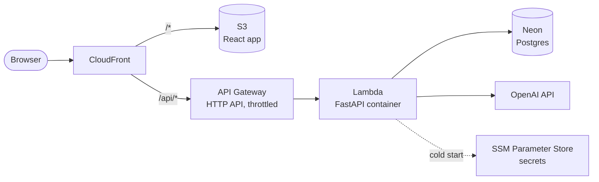

# AI Flashcards

Turn notes, PDFs and web pages into flashcards, then study them with spaced repetition.

**Live demo:** _coming soon_ · one click, no sign-up needed

An LLM writes focused question–answer cards, and the SM-2 algorithm (the one behind SuperMemo and early Anki) schedules each card right before you'd forget it. It runs serverless on AWS, with all infrastructure in Terraform and deploys from GitHub Actions.

## Features

- **Three ways in:** paste text, upload a PDF or give a URL
- **Spaced repetition:** a daily review queue with Again / Hard / Good / Easy grading and keyboard shortcuts
- **Decks:** organise, edit and add cards by hand; duplicates are skipped
- **Export** to Anki, CSV or JSON
- **Accounts:** email and password, or a one-click guest account that can be turned into a real one later
- **Progress:** due cards, reviews today and a study streak

## Architecture



| Layer | Tech |
|---|---|
| Frontend | React 18, TypeScript, Vite, React Router; tested with Vitest and Testing Library |
| Backend | FastAPI, SQLAlchemy 2, Alembic, Pydantic; tested with pytest against real Postgres |
| AI | OpenAI structured outputs, so responses are validated against a Pydantic schema |
| Infrastructure | Terraform: Lambda (container image), API Gateway, ECR, S3, CloudFront, IAM, SSM |
| CI/CD | GitHub Actions: lint, tests, migration checks, `terraform validate`, then deploy via OIDC |

## Design decisions

- **One origin, no CORS.** CloudFront serves the static app and sends `/api/*` to API Gateway, so the browser only ever talks to one domain. The Vite dev server proxies `/api` the same way locally.
- **The same container everywhere.** The backend is a plain uvicorn app. In Lambda, the [Lambda Web Adapter](https://github.com/awslabs/aws-lambda-web-adapter) translates events into HTTP, so there's no Lambda-specific code and `docker compose up` runs the exact production image.
- **Structured LLM output.** Generation uses OpenAI structured outputs with a Pydantic schema instead of parsing free-form JSON. Source text is fenced in `<document>` tags, and the model is told to treat it as material rather than instructions, as a guard against prompt injection from fetched pages. Refusals and truncated replies are handled explicitly rather than saved as broken cards.
- **Cost controls.** Every generation is recorded. Users and guests get daily quotas, a global daily cap bounds the API bill even if someone scripts guest sign-ups, and API Gateway throttles requests. Inputs are capped at 20,000 characters and 3 MB PDFs, the latter because Lambda's 6 MB request limit applies after base64 encoding. The model is one setting (`OPENAI_MODEL`).
- **SSRF protection on URL import.** Only `http(s)` is allowed, and every address the host resolves to must be public. Redirects are followed by hand and re-checked at each hop, and the response size is capped.
- **Secrets stay out of state.** API keys live in SSM Parameter Store and are read at cold start, so they never appear in Terraform state or the Lambda configuration. CI authenticates to AWS with OIDC, with no stored access keys, and only workflows on `main` can assume the deploy role.
- **Migrations are checked in CI.** `alembic upgrade`, `alembic check` (models and migrations agree) and `downgrade` run on every push.
- **Private by default.** Another user's deck returns the same 404 as a missing one, so IDs can't be probed.

## Running locally

Requires Docker (or Podman) and Node 22.

```bash
cp backend/.env.example backend/.env    # add your OpenAI API key and a JWT secret
docker compose up                        # Postgres + API on :8000, migrations applied
cd frontend && npm install && npm run dev   # app on http://localhost:5173
```

API docs are at http://localhost:8000/api/docs.

Tests:

```bash
cd backend && pip install -r requirements-dev.txt && pytest    # needs Postgres; see tests/conftest.py
cd frontend && npm test
```

## Deploying

One-time setup, about 15 minutes. Afterwards every push to `main` tests and deploys automatically.

1. **Database:** create a free [Neon](https://neon.tech) project in `aws-eu-central-1` and copy the pooled connection string.
2. **Secrets** (AWS CLI logged in):
   ```bash
   aws ssm put-parameter --type SecureString --name /ai-flashcards/database_url   --value 'postgresql://...'
   aws ssm put-parameter --type SecureString --name /ai-flashcards/openai_api_key --value 'sk-...'
   aws ssm put-parameter --type SecureString --name /ai-flashcards/jwt_secret     --value "$(openssl rand -hex 32)"
   ```
3. **Infrastructure.** Lambda needs an image to exist before it can be created, so the first apply happens in two steps:
   ```bash
   cd infra && terraform init
   terraform apply -target=aws_ecr_repository.api
   REPO=$(terraform output -raw ecr_repository_url)
   aws ecr get-login-password | docker login --username AWS --password-stdin "${REPO%%/*}"
   docker build --platform linux/amd64 --provenance=false -t "$REPO:bootstrap" ../backend && docker push "$REPO:bootstrap"
   terraform apply
   ```
4. **GitHub:** create a `production` environment. Add each value from `terraform output github_variables` as a repository variable, and `DATABASE_URL` as a secret (used for migrations).
5. Push to `main`.

**Cost:** AWS stays around $0–1/month at demo traffic. Lambda, API Gateway and CloudFront stay within their free tiers or near it, Neon's free tier doesn't expire, and the main fixed cost is ECR image storage at about $0.10/GB. OpenAI usage is billed separately and bounded by the daily quotas.

## Author

**Rafael Olaru** · [LinkedIn](https://www.linkedin.com/in/rafaelolaru/) · [GitHub](https://github.com/olarurafael)
